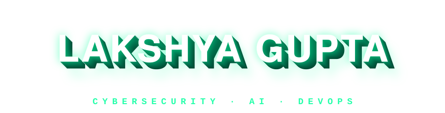

<div align="center">
  
</div>

<div align="center">
  <a href="https://git.io/typing-svg">
    
  </a>
</div>

<br/>

<div align="center">


</div>

---

```text
  ╭────────────────────────────────────────────────────╮
  │  OS:        BTech CSE (Cybersecurity), 2025-2029   │
  │  Host:      Vellore Institute of Technology        │
  │  Kernel:    Python / Java / C++ / C                │
  │  Shell:     Git, Linux CLI, Docker, Kubernetes     │
  │  Human:     English, Hindi                         │
  │  Uptime:    shipping AI systems & hackathon builds │
  ╰────────────────────────────────────────────────────╯
```

<div align="center">
  
</div>

---

### 📡 Currently

```yaml
learning:   [DSA, Cybersecurity fundamentals, Kubernetes, LLM agents]
building:   AI DevOps agents and grid-risk prediction systems
programme:  McKinsey Forward (Forward Learner)
open_to:    internships, hackathons, collaborations
```

---

### 🛠 Featured builds

| Project | What it does | Stack |
| ------- | ------------ | ----- |
| **[GridSense](https://github.com/Lakshya0023/GRIDSENSE)** | GAT-based power-grid risk prediction over ~22K assets and ~23K lines. Predict → Propagate → Pinpoint → Prevent pipeline with root-cause analysis, early warning, RUL estimation and what-if simulation | Python, PyTorch, GAT, FastAPI, React, PostgreSQL |
| **[AI DevOps Agent — Kubernetes Auto-Healing](https://github.com/Lakshya0023/YOUR-K8S-REPO)** | Closed-loop agent that detects, diagnoses, remediates and verifies Kubernetes failures using logs, metrics and cluster events | Python, LangGraph, Ollama, Prometheus, Grafana, Docker |
| **[BhoomiSeva — DEBUGGERS_INNOHACK](https://github.com/Lakshya0023/DEBUGGERS_INNOHACK)** | National digital land-governance platform: parcel registry, interactive map explorer, grievance tracking, ML price forecasting (InnoHack 2.0) | Flask, SQLite, D3.js, scikit-learn |
| **[Supply Chain & Warehouse Management](https://github.com/Lakshya0023/DATABASE_PROJECT)** | Full-stack inventory and logistics tracker covering purchase orders, sales orders and shipments across warehouses | Python, Flask, PostgreSQL |

---

### ⚙️ Toolbelt

<div align="center">


<br/><br/>


</div>

**Core concepts:** OOP · Data Structures & Algorithms · DBMS · Computer Networks · Cybersecurity Fundamentals

---

### 🏅 Certifications & learning

- **AI Tools & ChatGPT Workshop** — be10X (June 2026)
- **AI Tools Training** — House of EdTech (2026)
- **McKinsey Forward** — problem-solving, hypothesis-driven thinking and client communication

---

### 📊 GitHub stats

<div align="center">
  
  
</div>

<div align="center">
  
</div>

<div align="center">
  
</div>

---

<div align="center">

<a href="https://www.linkedin.com/in/lakshya-gupta-894483432"></a>
<a href="mailto:lakshyagupta5511@gmail.com"></a>

<br/>

*""Everything was fine until someone pushed to main.""*

</div>


